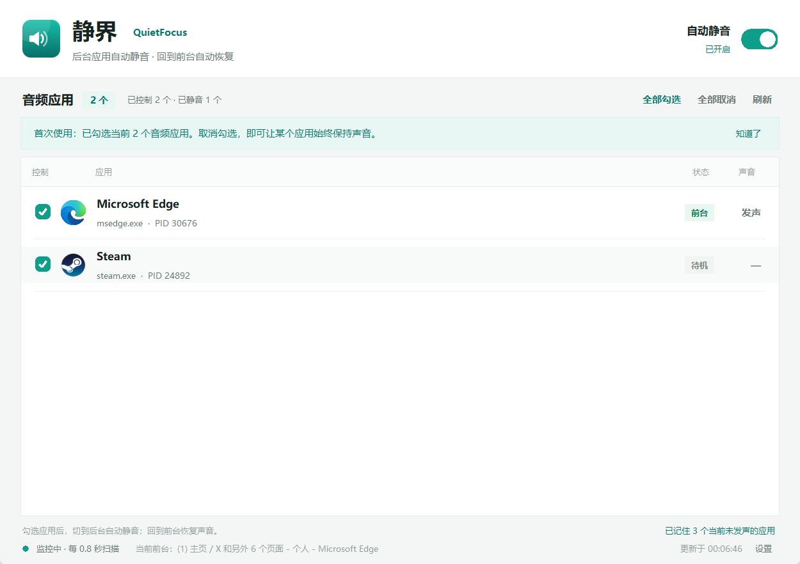
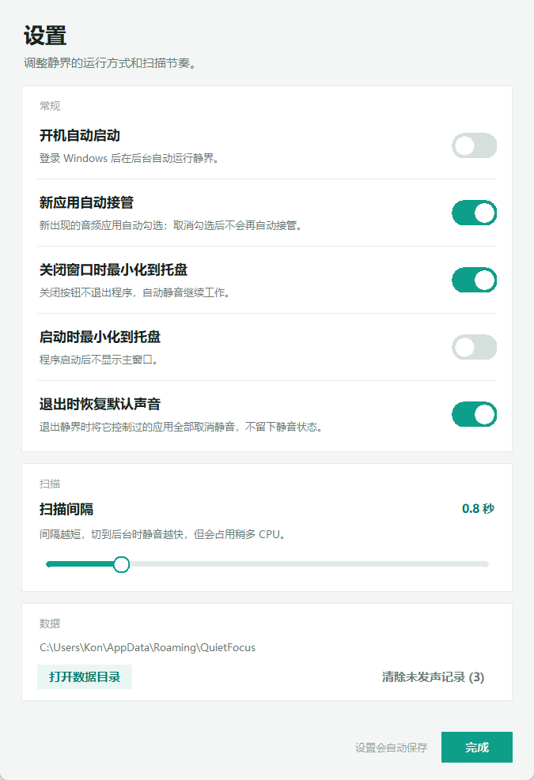

# 静界 QuietFocus

**Windows 后台应用自动静音工具。**  
识别当前音量合成器中的音频应用；被勾选的应用切到后台时自动静音，回到前台后自动恢复声音。




<sub>界面截图使用示例数据。</sub>

<details>
<summary>设置界面</summary>



</details>

## 主要功能

- 自动读取 Windows 当前默认播放设备上的所有音频会话，并按应用分组显示。
- 按应用的**前台/后台**状态自动切换静音，无需手动操作。
- 每个应用都有独立复选框，可单独控制；支持“全部勾选 / 全部取消”。
- 新出现的音频应用默认自动接管；取消勾选后不会再被自动勾选。
- 设置持久保存；退出软件时默认把它控制过的应用全部取消静音。
- 打开开始菜单/搜索（按 Win 键）也算离开当前应用，会触发自动静音。
- 崩溃/强制结束保护：静音前写入恢复日志，下次启动时自动恢复声音。
- 可选系统托盘、开机自启、关闭窗口后继续在后台运行。
- 支持中文界面、高 DPI 显示和 UWP/ApplicationFrameHost 窗口识别。

## 下载

不想自己构建的话，直接到 **[GitHub Releases](https://github.com/kon0303/QuietFocus/releases/latest)** 下载：

- `QuietFocus.exe`：单文件启动器
- `QuietFocus-1.0.2-portable.zip`：便携版

## 直接使用

### 方式一：单文件启动器（推荐）

把 `QuietFocus.exe` 放到**桌面、下载文件夹等可写目录**，然后双击运行。

首次运行会在 exe 旁边生成一个 `QuietFocus` 文件夹（这是程序运行所需的文件，不是安装程序），并自动启动主界面。之后再次双击会直接打开已运行的程序。

首次启动会显示当前正在使用音频的应用，并自动勾选它们。之后：

1. 点击每一行左侧的复选框，选择要交给静界控制的应用。
2. 应用在后台时显示“已静音”，切回前台后显示“发声”。
3. 右上角的“自动静音”总开关可以随时暂停/恢复全部控制。

> **SmartScreen 提示怎么办？**
> 程序未做数字签名，Windows 可能显示“Windows 已保护你的电脑”。  
> 点击提示中的 **“更多信息”**，再点击右下角出现的 **“仍要运行”** 即可。  
> 如果双击后提示“Could not create temporary directory”，说明旧版单文件解压方式失败；1.0.2 已改为在 exe 旁解压，不再依赖系统临时目录。  
> 如果公司电脑禁止运行未知程序，请改用便携版。

### 方式二：便携版（解压即用）

解压 `dist\QuietFocus-1.0.2-portable.zip`，运行其中的 `QuietFocus\QuietFocus.exe`。  
便携版不写系统目录，配置文件仍保存在 `%APPDATA%\QuietFocus`（可用下面的环境变量改到便携目录）。

### 命令行参数

```text
QuietFocus.exe --minimized   # 启动后直接隐藏到托盘
QuietFocus.exe --debug       # 输出调试日志
```

## 界面说明

| 区域 | 说明 |
| --- | --- |
| 控制 | 勾选后，该应用参与自动静音 |
| 应用 | 应用名称、进程名、PID、会话数 |
| 状态 | 前台 / 后台 / 待机（当前没有活跃音频） |
| 声音 | 发声 / 已静音 |
| 全部勾选 | 勾选当前所有应用，并清除它们的“不再接管”记录 |
| 全部取消 | 取消当前所有应用，并记住它们不再自动接管 |
| 自动静音 | 总开关；暂停时恢复所有被静界修改过的静音状态 |
| 设置 | 开机启动、新应用自动接管、托盘、退出恢复、扫描间隔、数据目录 |

### 第一次启动

首次启动会自动勾选当前所有音频应用。这样无需逐个设置即可开始工作；  
如果某个应用需要一直发声（例如音乐播放器），取消勾选它即可。

### 取消勾选后的行为

- 取消勾选会立即恢复该应用在静界接管前的静音状态。
- 在“新应用自动接管”开启时，未勾选的应用会被记住为“不再自动接管”，不会过一会儿又被勾上。
- “全部勾选”会清除这些记录并重新接管当前所有应用。

### 托盘/本程序窗口 vs 开始菜单

- 托盘溢出面板、任务栏、输入法候选窗口，以及静界自己的设置窗口，属于临时界面。打开它们不会把当前视频/游戏误判为后台。
- **开始菜单和 Windows 搜索不算临时界面**：按 `Win` 键或打开搜索后，当前应用已经不在前台，受控应用会静音；关闭开始菜单后恢复。
- 如果启动时还没有识别到真实的前台应用，界面会显示“等待前台应用…”，此时不会改动任何声音。

### 关闭窗口、最小化与退出

默认情况下，点击窗口右上角 `X` 只是**最小化到托盘**，后台监控继续运行，并不会退出。

要真正退出并恢复声音：

1. 右键任务栏托盘中的静界图标；
2. 选择 **“退出并恢复声音”**。

退出时默认会把它控制过的应用全部取消静音。若你希望退出时恢复“接管前的原始静音状态”，可在设置中关闭 **“退出时恢复默认声音”**。

### 托盘图标找不到时

如果托盘图标被 Windows 收进溢出面板、被安全软件隐藏，或点击无效：

1. 再次运行 `QuietFocus.exe`，已运行的主窗口会被直接唤起（不会启动第二份程序）。
2. 也可以在任务管理器中结束 `QuietFocus.exe` 后重新运行；下次启动会自动根据恢复日志还原之前被静音的应用。

## 运行要求

- Windows 10 21H2 及以上 / Windows 11，64 位。
- 当前默认播放设备（与 Windows 音量合成器一致）。
- 不需要管理员权限。
- 不联网、不收集遥测。

## 已知限制

- 只读取**当前默认播放设备**的音频会话。多声卡/多输出设备下，其他设备上的会话不会显示。
- “System Sounds”（系统提示音）没有所属进程，因此不会出现在列表中。
- 应用按可执行文件路径分组；同一应用启动多个进程时会合并为一行。
- 部分受保护进程/反作弊程序可能拒绝读取音频会话，此时该应用会显示为不可用或不出现在列表中。
- 极少数应用把音频放在独立的 helper 进程中，可能显示为单独一行；可分别勾选。
- 主程序被强制结束时，应用可能暂时保持静音；下次启动静界会自动根据恢复日志还原。
- 未做数字签名，SmartScreen 提示属于正常现象。
- 单文件启动器首次运行会在 exe 同目录生成 `QuietFocus` 文件夹；如果该目录不可写（例如 `Program Files`），运行时会自动放到 `%LOCALAPPDATA%\QuietFocus\app`。
- 单文件启动器本身未签名，SmartScreen 提示属于正常现象。

### 托盘图标没有出现

少数安全软件会阻止托盘消息过滤。此时静界会自动退化为“关闭窗口即退出”，不会在后台失联。  
如果需要稳定的托盘/开机后台运行，请将 `QuietFocus.exe` 加入安全软件白名单后重启程序。

## 数据与日志

默认目录：`%APPDATA%\QuietFocus`

| 文件 | 内容 |
| --- | --- |
| `settings.json` | 已勾选应用、总开关、扫描间隔、界面设置 |
| `restore.json` | 崩溃恢复日志；正常退出后会自动删除 |
| `quietfocus.log` | 运行日志，最大 1 MB，自动轮换 |

开发/测试时可覆盖数据目录：

```powershell
$env:QUIETFOCUS_DATA_DIR = "$PWD\.data-dev"
python app.py
```

## 从源码运行

需要 Python 3.12（3.10+ 通常也可）：

```powershell
python -m pip install -r requirements.txt
python app.py
```

调试运行：

```powershell
python app.py --debug
```

## 构建 EXE

```powershell
python -m pip install -r requirements-dev.txt
powershell -ExecutionPolicy Bypass -File .\build.ps1
```

若已把依赖安装在项目下的 `.vendor` 目录，脚本会自动加入 `PYTHONPATH`。  
构建单文件启动器还需要 Windows 自带的 .NET Framework 4.8 C# 编译器（`csc.exe`）。  
构建结果：

- `dist\QuietFocus.exe`：单文件启动器（内嵌运行包，首次运行在 exe 旁解压）
- `dist\QuietFocus\`：可直接运行的便携目录
- `dist\QuietFocus-1.0.2-portable.zip`：便携压缩包

## 测试

```powershell
$env:PYTHONPATH = "$PWD\.vendor"
python -m unittest discover -s tests -v
python tools\integration_audio_test.py
```

- `tests/test_audio_logic.py`：用假音频会话验证静音/恢复/崩溃日志状态机。
- `tests/test_config.py`：验证设置持久化、取消勾选记忆、间隔范围。
- `tools/integration_audio_test.py`：用静音 WAV 创建真实音频会话，验证 Core Audio 的发现、静音、恢复和线程生命周期。

## 目录结构

```text
app.py                     入口
quietfocus/
  audio.py                 Core Audio 会话扫描与静音状态机
  foreground.py            前台窗口/进程/UWP 识别
  config.py                设置持久化
  recovery.py              崩溃恢复日志
  winutil.py               Windows API 辅助
  tray.py                  系统托盘
  ui/
    main_window.py         主窗口与设置对话框
    widgets.py             自定义控件
    icons.py               应用图标提取
    theme.py               配色/字体
assets/                    应用图标
launcher/                  单文件启动器（C#，负责解压运行包）
tests/                     单元测试
tools/                     开发与集成测试工具
```

## 技术说明

- 音频：`pycaw` + Windows Core Audio `IAudioSessionManager2` / `ISimpleAudioVolume`。
- 前台判断：`GetForegroundWindow` + `GetWindowThreadProcessId`，并匹配子窗口 PID 与进程路径，兼容 Electron/Chromium、游戏启动器和 UWP 框架窗口。
- 扫描线程每 0.8 秒（可调）枚举一次会话，只在状态变化时调用 `SetMute`，避免频繁写音频接口。
- 静音前记录每个会话的原始静音状态；取消控制、暂停总开关时恢复原状态。正常退出默认强制取消静音，可在设置中改为恢复原状态。恢复日志保证崩溃后也能还原。

## 许可证

MIT，详见 [LICENSE](LICENSE)。
